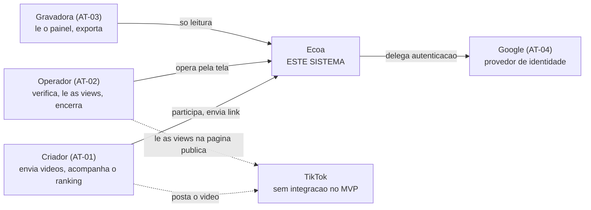
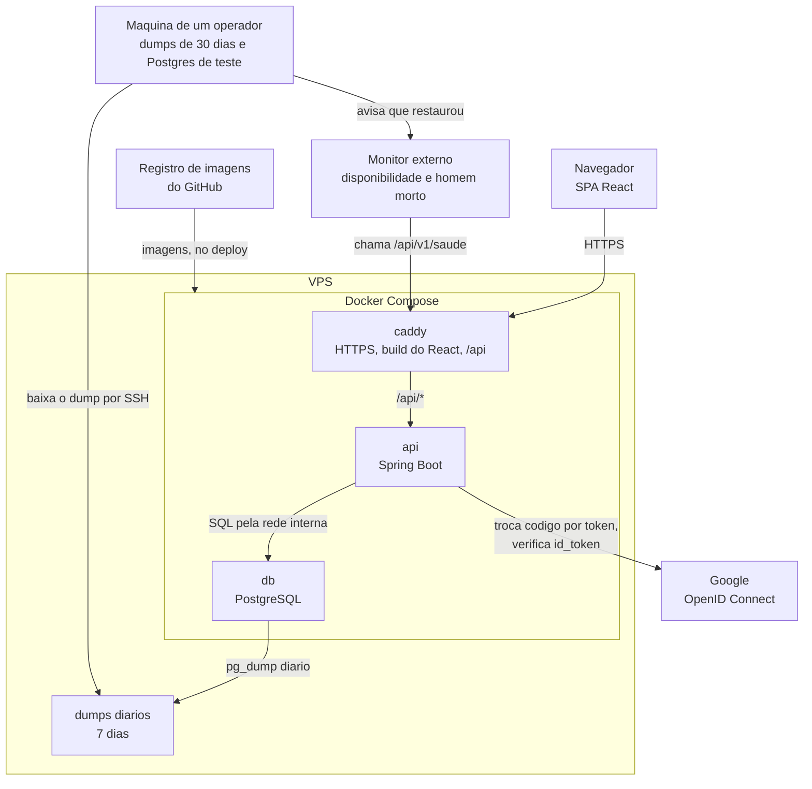

# Arquitetura

Duas vistas do modelo C4, contexto e contêiner, mais a vista de
desenvolvimento e a regra de dependência interna. Os níveis 3 e 4 do C4 não
estão aqui, e o motivo está no fim.

## Nível 1: contexto

Quem usa o sistema e com que sistema externo ele conversa.



O TikTok aparece tracejado: o criador posta lá e o operador lê lá, mas o
sistema nunca o chama (ADR-0001). Ele não é sistema externo do Ecoa, é o lugar
onde as pessoas trabalham por fora.

Não há outro sistema externo. Não existe serviço de e-mail (RN-56), nem
passarela de pagamento (RN-55), nem armazenamento de arquivo (RN-23).

## Nível 2: contêineres, em produção

O que roda onde, e por onde a requisição passa.



| Contêiner | Responsabilidade | Decisão |
|:--|:--|:--|
| SPA React | telas, estado de tela, validação de forma | ADR-0002, ADR-0010, ADR-0011 |
| caddy | HTTPS, entrega do build, `index.html` para caminho que não é arquivo, repasse de `/api` | ADR-0015 |
| api | regras de negócio, contrato de API, autenticação, função | ADR-0002, ADR-0008, ADR-0009 |
| db | dado, restrições de integridade | ADR-0004, ADR-0015 |
| dumps diários | cópia na VPS, 7 dias, de onde o operador baixa e o ensaio restaura | ADR-0006, ADR-0016 |
| máquina do operador | segunda cópia, 30 dias, restauração diária de teste | ADR-0016 |

A migração e o ensaio não aparecem: são passos do deploy que rodam e terminam
(ADR-0006, ADR-0017), não serviços no ar.

Três propriedades que essa vista fixa, e que valem mais que o desenho:

**Origem única.** O navegador conhece um endereço só. Isso apaga a configuração
de origem cruzada, deixa o cookie funcionar sem marca especial e faz existir um
único endereço de retorno no Google (ADR-0008, ADR-0015).

**O banco não é alcançável de fora.** Ele existe só na rede interna do Compose,
e nenhum caminho do diagrama chega nele sem passar pela api (RNF-20).

**Três portas abertas, e só elas.** A VPS abre 22 para SSH com chave, e 80 e 443
para o Caddy (RNF-19).

## Desenvolvimento

Tudo na máquina de quem desenvolve, sem VPS (RNF-27):

- o Postgres roda em Docker, pelo `compose.dev.yml` da raiz, e é o único
  contêiner;
- a api roda direto na máquina, no perfil de desenvolvimento, que liga o
  springdoc de onde saem os tipos do frontend (ADR-0010);
- o servidor do Vite entrega o frontend e repassa `/api` para a api local,
  reproduzindo a origem única da produção;
- o endereço local de retorno do login também fica cadastrado no projeto do
  Google.

## A regra de dependência interna

Em vez das camadas completas de Clean Architecture, uma regra só (ADR-0012):

> O pacote de regras não importa Spring nem JPA.

Traduzida em estrutura de pasta do backend:

```
backend/src/main/java/ecoa/
  controller/   Spring MVC: recebe, chama o service, devolve DTO
  service/      abre a transação, chama repository e regras
  repository/   Spring Data JPA: as consultas
  entity/       JPA: as tabelas
  dto/          records: entrada e saída de cada rota
  mapper/       conversão entre entidade e DTO, escrita à mão
  exception/    tratador global e formato único de erro
  config/       segurança, relógio e configuração
  comando/      os modos migrar e cadastrar-operador
  regras/       não importa nada além da biblioteca padrão do Java
```

A direção é sempre a mesma: **todos podem importar `regras/`, e `regras/` não
importa ninguém.** Ela recebe dados e devolve valores.

Três regras concretas que vêm da mesma família:

- O controller não decide nada. Ele chama quem decide.
- A função de regra recebe dados, não o repositório.
- O banco só é consultado dentro do service (ADR-0005).

**Como isso se verifica em vez de se prometer:** um teste de arquitetura com o
ArchUnit falha se alguma classe de `regras/` importar `org.springframework` ou
`jakarta.persistence`, ou se algum controller usar repository direto (ADR-0012).
Sem ele, a regra é comentário.

## Os níveis 3 e 4 do C4 não estão aqui

**Componente** desenharia as peças dentro da api. A estrutura de pasta acima já
diz isso em poucas linhas, e um diagrama de componente fica desatualizado no
primeiro refactor, porque descreve exatamente o que mais muda.

**Código** desenharia classes e funções. Isso é o código, e o código é a única
descrição dele que não pode divergir dele.

A pergunta que decide se um diagrama vale: ele mostra algo que não se descobre
lendo a pasta? Contexto e contêiner mostram (o TikTok fora do sistema, a origem
única, o banco isolado, a cópia na máquina do operador). Componente e código
não.
